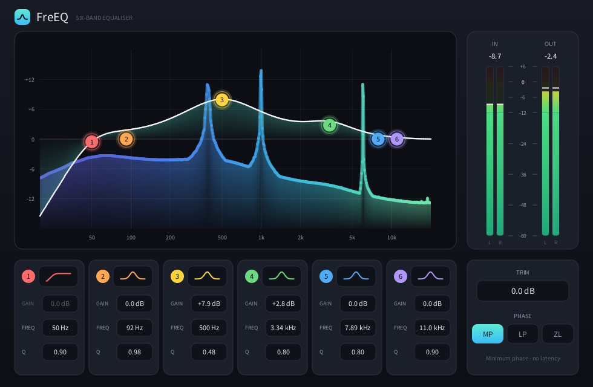

# FreEQ

[](https://github.com/MistaMin/FreEQ/releases/latest)
[](LICENSE)
-lightgrey)

A six-band equaliser written in Rust on the [OpenPlugin SDK](https://github.com/MistaMin/OpenPluginSDK). The face and the live spectrum are drawn with GoodLookin DRI.



## Features

- **Six bands.** Each is a peak, high pass, low pass, low shelf or high shelf, from 20 Hz to 20 kHz, with gain, frequency and Q.
- **Types you can see.** The filter type is a symbol on a button. A click steps to the next type. Peaks and shelves flip when the band cuts.
- **Three phase modes.** Minimum phase (no delay), linear phase (512 samples) and Analog ZL (no delay, closer to the analogue shape in the top octave). Linear phase and Analog ZL play a 1024-tap impulse through the SDK's `BlockConvolver`.
- **Meters.** Stereo input and output meters with peak hold. The bar falls at 20 dB per second, and the hold marker waits 1.5 seconds. The input meter reads before the first band, the output meter after trim.
- **Live spectrum.** A click on empty plot steps it between live, frozen and off. Off costs no FFT.
- **Light on the CPU.** One minimum-phase instance uses about 0.01% of a core idle and 0.12% fully loaded. The linear-phase modes use about 0.17%. See [FREEQ.md](FREEQ.md).

## Download

Get the installer from the [latest release](https://github.com/MistaMin/FreEQ/releases/latest). It is signed with a Developer ID and notarized by Apple.

| Format | Installs to |
|---|---|
| VST3 | `/Library/Audio/Plug-Ins/VST3` |
| Audio Unit | `/Library/Audio/Plug-Ins/Components` |
| AAX | `/Library/Application Support/Avid/Audio/Plug-Ins` |
| CLAP | `/Library/Audio/Plug-Ins/CLAP` |
| LV2 | `/Library/Audio/Plug-Ins/LV2` |
| Standalone | `/Applications` |

The installer lets you choose which formats to install. The binaries are arm64 and need macOS 11 or later.

## Limits of 0.2.0

- The FreEQ editor is in the **standalone app**. The plugin formats show the host's own parameter controls.
- The **LV2** build has audio ports only, so a host cannot reach the parameters.
- In REAPER, the **VST3** build did not restore Bands 1 to 5 after save and reopen, and the **CLAP** build restored most band values to defaults. The Audio Unit restored all values.
- The **AAX** build passes five of six AAX Validator tests (no page table) and has not been tried in Pro Tools.

These come from the OpenPlugin SDK's format shells, not from FreEQ's DSP. [FREEQ.md](FREEQ.md) has the details.

## Build

You need Rust and the OpenPlugin SDK and GoodLookin checkouts at the paths named in [`openplugin-eq/Cargo.toml`](openplugin-eq/Cargo.toml).

```sh
cargo build --release --manifest-path openplugin-eq/Cargo.toml --bin openplugin-eq   # the standalone window
cargo test  --release --manifest-path openplugin-eq/Cargo.toml                       # 13 tests
openplugin-eq/target/release/openplugin-eq --smoke                                   # draws a frame and exits 0
```

The VST3, Audio Unit, AAX, CLAP and LV2 builds come from the SDK's native shells. The build is in the SDK's [`docs/SHELL.md`](https://github.com/MistaMin/OpenPluginSDK/blob/main/docs/SHELL.md).

## Documents

- [FREEQ.md](FREEQ.md): the filters, the test, the CPU numbers and the playback code.
- [FreEQ-Report.pdf](FreEQ-Report.pdf): the 0.1.0 measurement report.
- [shots/](shots/): editor pictures.

## License

The source code is under the [MIT License](LICENSE).

The official compiled plug-ins, standalone application and installers are **proprietary freeware**: free to use for personal and commercial audio production under the [binary freeware license](BINARY_LICENSE.txt). They are not distributed under an open-source license. Third-party components and their licenses are listed in [THIRD_PARTY_LICENSES.md](THIRD_PARTY_LICENSES.md), and the license texts are installed with the binaries.

Copyright (c) 2026 Marcos Quirino Deida.

AAX and Pro Tools are trademarks of Avid Technology, Inc. VST is a trademark of Steinberg Media Technologies GmbH.
